<div align="center">



<br><br>


<p>
  <a href="https://github.com/VictorRamosHC"></a>
  <a href="https://github.com/VictorRamosHC?tab=repositories"></a>
  <a href="https://github.com/VictorRamosHC/hugh-player/releases/latest"></a>
</p>

</div>

---

## ◼ [ 01 // ENGENHARIA & MINDSET ]

Não me defino por uma única camada do stack. Projeto sistemas de ponta a ponta — produto, interface, APIs, dados, CI/CD e segurança — tratando cada componente como parte de uma solução coerente. Desenvolvo soluções web e Android nativo com interesse contínuo em cibersegurança, modelagem de ameaças e hacking ético. Uso IA como ferramenta de engenharia: prototipo, reviso código e automatizo build com agentes, mantendo arquitetura e validação sob supervisão humana.

```text
[ CORP.NET ] [ SURFACE: FULL-STACK ] [ SECURITY: THREAT-AWARE ] [ MODE: BUILD / REFACTOR / HARDEN ]
```

---

## ◼ [ 02 // LINHA DE EVOLUÇÃO ]

<div align="center">
  
</div>

---

## ◼ [ 03 // SISTEMAS EM DESTAQUE ]

| Sistema | O que demonstra | Stack | Acesso |
| :--- | :--- | :--- | :---: |
| [**Aether Vault**](https://github.com/VictorRamosHC/hugh-player) | Player Android offline, DSP 5 bandas, letras .LRC sincronizadas, temas e CI/CD | Kotlin · Compose · Media3 · Room | [](https://github.com/VictorRamosHC/hugh-player/releases/latest) |
| [**Prisma House Painter**](https://github.com/VictorRamosHC/Prisma-House-painter) | Plataforma institucional, design system moderno e arquitetura escalável | Next.js · React · TypeScript · Tailwind | [](https://prisma-house-painter.vercel.app) |
| [**GlassTask**](https://github.com/VictorRamosHC/Gerenciador-de-tarefas) | Gerenciador de tarefas com Glassmorphism, persistência local e métricas | Vanilla JS · CSS · localStorage | [](https://gerenciador-de-tarefas-one-gold.vercel.app) |
| [**Cassino Reverso**](https://github.com/VictorRamosHC/cassino-reverso) | Simulador educacional de probabilidade e conscientização financeira | Next.js · TypeScript · Tailwind | [](https://cassino-reverso.vercel.app) |
| [**ProjetoViagem**](https://github.com/VictorRamosHC/ProjetoViagem) | Fundamentos web, ponto de origem da trajetória | HTML · CSS | [](https://github.com/VictorRamosHC/ProjetoViagem) |

---

## ◼ [ 04 // INTERACTIVE SYSTEMS ]

> Cada minigame é uma simulação interativa vinculada a um projeto real. Nenhum framework, nenhuma dependência externa — código soberano rodando offline.

| Sistema | Descrição | Acessar |
| :--- | :--- | :---: |
| **Signal Route** | Mapeie o caminho correto entre nós de rede sem cruzar rotas. Vinculado a ProjetoViagem. | [](./minigame/signal-route/index.html) |
| **Task Triage** | Priorize o backlog antes do colapso operacional. Vinculado a GlassTask. | [](./minigame/task-triage/index.html) |
| **Color Protocol** | Reconstrua a composição visual da fachada por RGB. Vinculado a Prisma House Painter. | [](./minigame/color-protocol/index.html) |
| **Audio Breach** | Sincronize frequência, ritmo e sinal via Web Audio API. Vinculado a Aether Vault. | [](./minigame/audio-breach/index.html) |

---

## ◼ [ 05 // ARSENAL TECNOLÓGICO ]

<p>
  
  
  
  
  
  
  
</p>

> *"Segurança não é um adesivo colado no fim do projeto: é a lente arquitetural para decidir o que construir, o que expor e o que validar."*

---

## ◼ [ 06 // TELEMETRIA ]

<div align="center">
  
  
</div>

<div align="center">
  
</div>

---

<div align="center">
  
</div>
