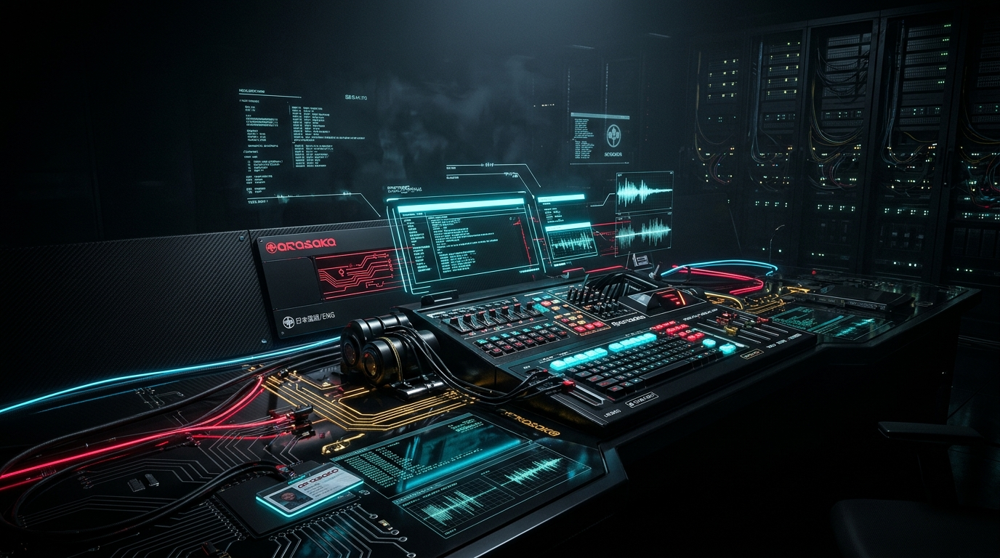

<div align="center">



<br><br>


<p>
  <a href="https://github.com/VictorRamosHC"></a>
  <a href="https://github.com/VictorRamosHC?tab=repositories"></a>
  <a href="https://github.com/VictorRamosHC/hugh-player/releases/latest"></a>
</p>

<h3>Projetando sistemas de ponta a ponta — da interface ao dado, da concepção à entrega de alta fidelidade.</h3>

</div>

---

<div align="center">
  
</div>

<br>

<details>
<summary>🕹️ <strong>[ MINIGAME HACKER // PROTOCOLO DE DESCRIPTOGRAFIA ]</strong> <em>(Clique para interagir com o terminal)</em></summary>

<br>

```ansi
 [ NETRUNNER CONSOLE v2.0.77 // NODE: ARASAKA_SUB_VAULT ]
 > SELECIONE O VETOR DE INTRUSÃO PARA LIBERAR O PAYLOAD:

 1. [BUFFER_OVERFLOW_MEDIA3]  --> DESCRIPTOGRAFAR EQUALIZADOR DSP 5 BANDAS
 2. [QUANTUM_DECRYPT_LRC]    --> SINCRONIZAR LETRAS MILISSEGUNDO A MILISSEGUNDO
 3. [ICE_BREAKER_OFFLINE]     --> ATIVAR SÍNTESE DE VOZ TTS SOBERANA
```

> **Acesso Concedido:** `STATUS: 200 OK` // *Todos os vetores foram compilados com sucesso no Aether Vault v1.5.0.*  
> 🎮 **Quer jogar o minigame de Breach Protocol real com áudio e matriz hex?** [Abra o minigame web aqui](minigame/index.html)!

</details>

---

## ⚡ [ 01 // PERFIL DE ENGENHARIA & MINDSET ]

Não me defino por uma única camada do stack. Gosto de entender o sistema inteiro — produto, ergonomia de interface, APIs, pipelines de dados, automação CI/CD, observabilidade e segurança — transformando cada componente em uma solução resiliente e elegante. Front-end, back-end, banco de dados e engenharia nativa são etapas do mesmo ciclo: domino a receita completa para entregar valor de ponta a ponta.

- **Cibersegurança & Hacking Ético:** Interesse contínuo e estudo prático de segurança ofensiva, vetores de ataque, modelagem de ameaças e hardening de sistemas com responsabilidade. A cultura cyberpunk e o imaginário netrunner servem como linguagem estética e lembrete constante de que resiliência se constrói na fundação.
- **Engenharia Aumentada por IA:** Orquestração de agentes de inteligência artificial para prototipação ultrarrápida, caça a condições de corrida, testes de estresse e CI em nuvem — mantendo a arquitetura, as decisões críticas de segurança e a validação final sob rigoroso controle humano.
- **Linha Evolutiva:** `ProjetoViagem` ➔ `GlassTask` ➔ `Prisma House Painter` ➔ `Aether Vault`.

```text
[ CORP.NET ] [ SURFACE: FULL-STACK ] [ SECURITY: THREAT-AWARE ] [ MODE: BUILD / REFACTOR / HARDEN ]
```

---

## 🏛️ [ 02 // SISTEMAS EM DESTAQUE ]

| Sistema | O Que Demonstra | Stack & Engenharia | Ação |
| :--- | :--- | :--- | :---: |
| [**Aether Vault**](https://github.com/VictorRamosHC/hugh-player) | Player Android offline soberano, motor de áudio Media3 ExoPlayer, DSP 5 bandas, letras .LRC e CI/CD | `Kotlin 2.0` · `Compose` · `Media3` · `Room` | [](https://github.com/VictorRamosHC/hugh-player/releases/latest) |
| [**Prisma House Painter**](https://github.com/VictorRamosHC/Prisma-House-painter) | Plataforma institucional com design system moderno, componentes desacoplados e alta performance | `Next.js` · `React` · `TypeScript` · `Tailwind` | [](https://prisma-house-painter.vercel.app) |
| [**GlassTask**](https://github.com/VictorRamosHC/Gerenciador-de-tarefas) | Aplicação interativa de produtividade com Glassmorphism, persistência local e métricas em tempo real | `Vanilla JS` · `CSS Glass` · `localStorage` | [](https://gerenciador-de-tarefas-one-gold.vercel.app) |
| [**Cassino Reverso**](https://github.com/VictorRamosHC/cassino-reverso) | Simulador educacional gamificado para conscientização matemática e probabilística | `Next.js` · `TypeScript` · `Tailwind` | [](https://cassino-reverso.vercel.app) |
| [**ProjetoViagem**](https://github.com/VictorRamosHC/ProjetoViagem) | Fundamentos de estruturação semântica web e o marco inicial da jornada | `HTML5` · `CSS3` | [](https://github.com/VictorRamosHC/ProjetoViagem) |

---

## 🛠️ [ 03 // ARSENAL TECNOLÓGICO ]

<p>
  
  
  
  
  
  
  
</p>

> *"Segurança não é um adesivo colado no fim do projeto: é a lente arquitetural para decidir o que construir, o que expor e o que validar."*

---

## 📊 [ 04 // TELEMETRIA DE SISTEMA ]

<div align="center">
  
  
</div>

<div align="center">
  
</div>

---

<div align="center">
  
</div>